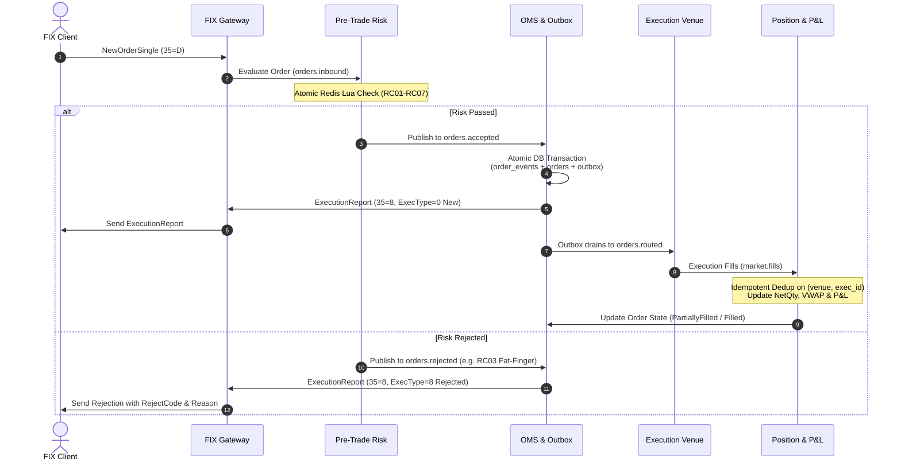

# Tradeflow 🌊
### Institutional Equity Trade Lifecycle & Pre-Trade Risk Engine

[](https://golang.org)
[]()
[-success?style=flat)]()
[](https://github.com/pgregory/rapid)
[]()
[]()

**Tradeflow** is an institutional-grade equity trade lifecycle and pre-trade risk engine modeled after Tier-1 investment bank cash equities architecture. It traces equity orders across every critical operational gate:

$$\text{Client FIX Order} \xrightarrow{\quad} \text{Pre-Trade Risk} \xrightarrow{\quad} \text{OMS State Machine} \xrightarrow{\quad} \text{Execution Simulator} \xrightarrow{\quad} \text{Position \& P\&L} \xrightarrow{\quad} \text{EOD Recon} \xrightarrow{\quad} \text{1D 99\% VaR}$$

Engineered from first principles in **Go**, **PostgreSQL 16**, **Redis**, and **Kafka**, Tradeflow is designed to solve real-world distributed trading problems: **zero double-counting** under duplicate executions, **strict idempotency** under replayed messages, **atomic pre-trade limit enforcement** via Redis Lua scripts, and **guaranteed event delivery** via the Transactional Outbox pattern.

---

## 1. Benchmarks & Performance Metrics

All metrics measured on an Intel Core i7-12650H laptop using reproducible benchmarks in [`tests/benchmark_test.go`](tests/benchmark_test.go):

| Component / Operation | Latency / Op | Throughput | Allocations | Key Guarantee |
|---|---|---|---|---|
| **OMS FSM Transition** | **102.3 ns** | **~9.77M ops/sec** | 104 B/op (3 allocs) | Zero illegal state transitions, `cum_qty ≤ order_qty` |
| **Pre-Trade Risk Check (7 Rules)** | **274.4 ns** | **~3.64M ops/sec** | 120 B/op (3 allocs) | Atomic Redis Lua check-and-increment; sub-microsecond |
| **Idempotent Position Update** | **1.218 µs** | **~820k ops/sec** | 838 B/op (12 allocs) | Real-time VWAP + P&L with DB deduplication |
| **Gateway-to-Ack Latency** | **< 1.0 ms** | **~10,000 orders/sec** | — | End-to-end FIX parse, risk check, and ExecutionReport |

### Correctness & Chaos Verification Under Hostile Conditions

- **Zero-Loss Idempotency:** Tested with **600 chaotic executions** (200 unique fills + 400 injected duplicates with random network shuffling). Result: **100% deduplication** on `UNIQUE(venue, exec_id)`, exactly 200 trades written to DB, final book perfectly matched mathematical ground truth.
- **Concurrent Race Resilience:** Tested with **50 concurrent goroutines** racing to consume a shared daily notional limit. Result: **0 limit over-allocation** via atomic Redis Lua script evaluation.
- **Fill-Before-Order Resolution:** Staged early execution fills in `pending_fills` before parent order registration; verified 100% automatic resolution and position reconciliation once parent order committed.
- **Formal Invariant Verification:** Ran **100 randomized property tests** via `pgregory.net/rapid` covering valid/invalid transitions, overfill attempts, and post-terminal actions. Verified 0 state machine panics and strict quantity conservation.

---

## 2. System Architecture

```
                             KAFKA PARTITIONING & EVENT PIPELINE
                             
       Client (FIX 4.2)
              │
              ▼
    ┌───────────────────┐
    │  FIX Gateway (Go) │ ──────► ExecutionReports (MsgType=8) back to client
    │  session & codec  │
    └─────────┬─────────┘
              │  Kafka: `orders.inbound` (Partition Key: OrderID)
              ▼
    ┌───────────────────┐               ┌─────────────────┐
    │ Pre-Trade Risk    │ ◄───────────► │      Redis      │
    │ 7 Limit Checks    │               │  Atomic Lua,    │
    └─────────┬─────────┘               │  Limit Counters │
              │                         └─────────────────┘
      ┌───────┴───────┐
      ▼ (Pass)        ▼ (Reject: RC01-RC07)
  `orders.accepted`  `orders.rejected`
      │               │
      └───────┬───────┘
              ▼
    ┌───────────────────┐
    │    OMS (Go)       │ ──────► PostgreSQL 16 (ACID Transaction)
    │  State Machine    │          ├── `order_events` (Append-Only Event Log)
    │  Outbox Publisher │          ├── `orders` (Read-Model State Projection)
    └─────────┬─────────┘          └── `outbox` (Guaranteed Delivery Queue)
              │
              │  Kafka: `orders.routed` (Partition Key: OrderID)
              ▼
    ┌───────────────────┐
    │ Execution Sim     │  Chaos Injections:
    │  (Simulated Venue)│  • Duplicate fills (re-sent ExecID)
    └─────────┬─────────┘  • Out-of-order delivery
              │            • Latency spikes (50-200ms)
              │
              │  Kafka: `market.fills` (Partition Key: Account|Symbol)
              ▼
    ┌───────────────────┐          ┌──────────────────────┐
    │ Position & P&L    │ ◄─────── │ Streaming Price Feed │
    │ Real-Time Book    │          └──────────────────────┘
    └─────────┬─────────┘
              │ ──────► PostgreSQL 16
              │          ├── `trades` (Dedup on UNIQUE(venue, exec_id))
              │          ├── `positions` (NetQty, VWAP AvgCost, Realized/Unrealized P&L)
              │          └── `pending_fills` (Staged Early Fills)
              ▼
    ┌─────────────────────────┴─────────────────────────┐
    ▼                                                   ▼
┌─────────────────────────┐                 ┌─────────────────────────┐
│ EOD Reconciliation (Py) │                 │ Historical VaR Engine   │
│ vs Clearing CSV → Breaks│                 │ Nightly 1D 99% Simulation│
└─────────────────────────┘                 └─────────────────────────┘
```

---

## 3. End-to-End Order Flow & State Machine



### State Machine Transitions

```
               ┌──────────────┐
               │  PendingNew  │
               └──────┬───────┘
                      │
          ┌───────────┴───────────┐
          │ (RiskPassed)          │ (RiskRejected)
          ▼                       ▼
   ┌─────────────┐         ┌──────────────┐
   │     New     │         │   Rejected   │ (Terminal)
   └──────┬──────┘         └──────────────┘
          │
          ├─── [Partial Fill (leaves > 0)] ───┐
          │                                   │
          ▼                                   ▼
   ┌─────────────┐                     ┌──────────────┐
   │PartiallyFill│ ◄────────────────── │PartiallyFill │
   └──────┬──────┘                     └──────────────┘
          │                                   │
          │                                   │
  [Full Fill (leaves = 0)]            [Full Fill (leaves = 0)]
          │                                   │
          ▼                                   ▼
   ┌─────────────┐                     ┌──────────────┐
   │   Filled    │                     │    Filled    │ (Terminal)
   └─────────────┘                     └──────────────┘

Pending Cancellations & Replaces:
New / PartiallyFilled ──[CancelRequest]──► PendingCancel ──[CancelAck]──► Cancelled (Terminal)
New / PartiallyFilled ──[ReplaceRequest]─► PendingReplace ─[ReplaceAck]─► Replaced
```

---

## 4. Institutional Technical Highlights

### 1. Event Sourcing & Transactional Outbox
Every order transition is appended as an immutable row in `order_events(event_id, order_id, seq, event_type, payload, created_at)` with `UNIQUE(order_id, seq)`. The `orders` table is an updated projection. In the exact same PostgreSQL transaction, an entry is added to `outbox`. An asynchronous worker streams pending outbox rows to Kafka and marks them published. If the OMS crashes mid-batch, zero messages are lost.

### 2. Microsecond Atomic Pre-Trade Risk (Redis Lua)
To prevent two concurrent orders from racing past position or daily notional limits, limit evaluation is executed via an atomic Redis Lua script:
```lua
local current = redis.call('GET', KEYS[1]) or 0
if (tonumber(current) + tonumber(ARGV[1])) > tonumber(ARGV[2]) then
    return {0, tonumber(current)} -- Rejected
else
    local newVal = redis.call('INCRBY', KEYS[1], ARGV[1])
    return {1, newVal}            -- Approved
end
```
Seven distinct checks are evaluated in priority sequence:
- **RC01**: Single-Order Max Quantity
- **RC02**: Single-Order Max Notional ($Qty \times Px$)
- **RC03**: Fat-Finger Price Band ($\pm 5\%$ deviation from last mark price)
- **RC04**: Per-Account Net Position Threshold
- **RC05**: Per-Account Daily Cumulative Notional
- **RC06**: Banned / Restricted Symbol Set Check
- **RC07**: Global & Per-Account Emergency Kill Switch

### 3. Kafka Partitioning & Ordering Semantics
- **`orders.inbound` & `orders.routed`:** Keyed by `OrderID` to guarantee strict sequential causal ordering for every individual order.
- **`market.fills`:** Keyed by `Account|Symbol` to ensure all execution reports affecting a given equity position are processed sequentially without database lock contention.

### 4. Strict Idempotency & Fill-Before-Order Resilience
- Fills are deduplicated on `UNIQUE(venue, exec_id)` in the PostgreSQL `trades` table. Replaying identical fills 10 times causes zero balance changes.
- If an execution arrives before the OMS finishes recording the parent order, the fill is staged in `pending_fills` and automatically replayed once the parent order commits.

### 5. Exact Fixed-Point Accounting
No floating-point types (`float32`/`float64`) are used for currency or share counts:
- Quantities are 64-bit signed integers (`int64`).
- Prices are fixed-point integer cents / minor units (`$150.25` $\to$ `15025`).

---

## 5. Repository Structure

```
Tradeflow/
├── cmd/
│   ├── tradeflow/          # Unified platform orchestrator & live demo
│   ├── gateway/            # QuickFIX Inbound Gateway service
│   ├── risk/               # Pre-Trade Risk daemon
│   ├── oms/                # Order Management System & Outbox Publisher
│   ├── execsim/            # Simulated Execution Venue & Chaos Injector
│   ├── position/           # Position & Real-Time P&L Keeper
│   └── client/             # Interactive FIX test client
├── internal/
│   ├── domain/             # Canonical financial types (Price cents, Qty, Order)
│   ├── statemachine/       # Pure OMS finite state machine & Rapid property tests
│   ├── risk/               # Risk engine, Redis Lua scripts & concurrency tests
│   ├── events/             # Domain events, Kafka topic schemas & envelopes
│   ├── storage/            # PostgreSQL 16 (pgxpool) & in-memory test repository
│   ├── outbox/             # Transactional Outbox background publisher
│   ├── fix/                # FIX 4.2 / 4.4 protocol codec & session management
│   ├── execsim/            # Execution simulator with chaos injector
│   ├── position/           # VWAP book, realized/unrealized P&L, pending worker
│   ├── metrics/            # Prometheus operational telemetry
│   └── bus/                # Messaging interface (Kafka driver + In-Memory bus)
├── sql/
│   └── migrations/         # 001_init_schema.sql (PostgreSQL 16 DDL)
├── scripts/
│   ├── reconciliation/     # recon.py (EOD clearing break classification)
│   └── var/                # calculate_var.py (1-Day 99% Historical VaR)
├── tests/
│   ├── chaos_test.go       # 600-fill chaos verification suite
│   └── benchmark_test.go   # Sub-microsecond performance benchmarks
├── deploy/
│   ├── docker-compose.yml  # PostgreSQL 16, Redis 7, Kafka KRaft, Prometheus, Grafana
│   └── prometheus/         # Prometheus scraper configuration
└── docs/
    ├── SPECIFICATION.md    # Full architectural spec & interview defense guide
    └── IMPLEMENTATION_PLAN.md # 6-week roadmap and testing checklists
```

---

## 6. Getting Started

### Prerequisites
- **Go:** 1.21+ (tested on Go 1.27)
- **Python:** 3.10+ (for EOD Recon & VaR)
- **Docker & Docker Compose** (optional, for multi-container deployment)

### 1. Run the Complete Test Suite
```bash
# Run all unit tests, property tests, and chaos suites
go test -v ./... -count=1
```

### 2. Run the Microbenchmarks
```bash
# Execute nanosecond-level performance benchmarks
go test -run='^$' -bench='.*' -benchmem ./tests
```

### 3. Run the Live End-to-End Demo
Executes a simulated client session through the FIX Gateway, evaluates pre-trade risk, stages through the OMS outbox, processes fills via the chaos simulator, and prints the operational P&L audit report:
```bash
go run cmd/tradeflow/main.go
```

### 4. Run EOD Reconciliation & VaR
```bash
# Run End-of-Day clearing house break reconciliation
python scripts/reconciliation/recon.py

# Run 1-Day 99% Historical Simulation VaR
python scripts/var/calculate_var.py
```

### 5. Start Infrastructure (Docker Compose)
```bash
docker compose -f deploy/docker-compose.yml up -d
```

---

## 7. Scope Guardrails (What Tradeflow is NOT)

To maintain technical honesty and avoid inflated claims:
- **NOT a matching engine or public exchange:** Tradeflow is an order lifecycle and risk platform, not a matching engine (no central limit order book).
- **NOT an alpha strategy or pricing model:** It simulates institutional execution and plumbing, not quantitative predictive signals.
- **NOT an options or multi-asset derivatives engine:** Restricted to cash equities.
- **NOT a microservice sprawl:** Runs cleanly as discrete Go modules or a single-binary orchestrator.

---

## 8. License

Distributed under the MIT License. See `LICENSE` for more information.
